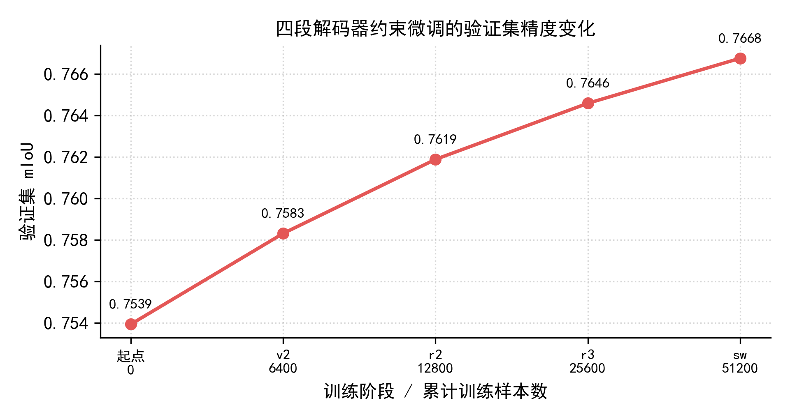
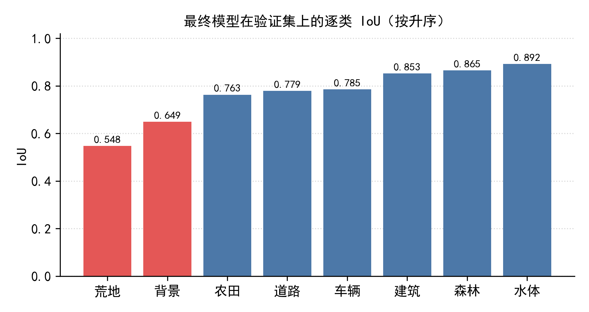
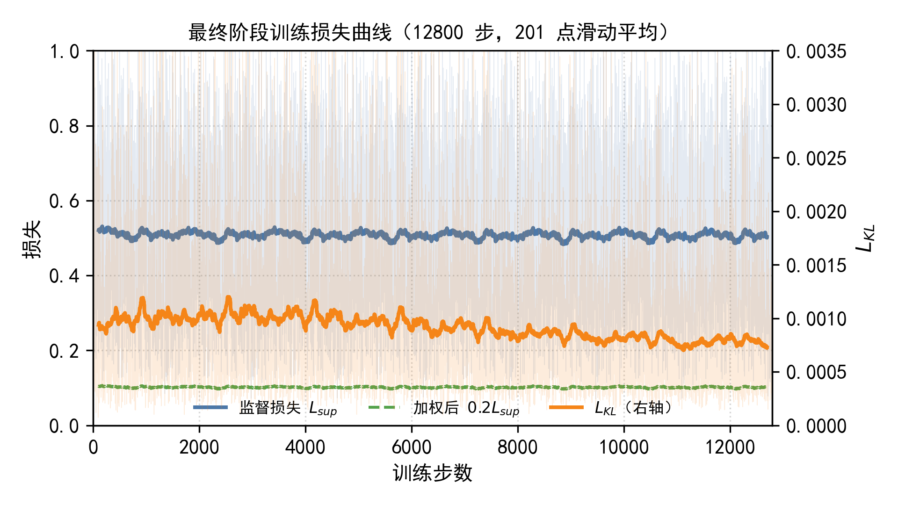

# UAV Image Semantic Segmentation

> 基于 KAN 网络的无人机低空航拍影像语义分割 —— Swin-B 编码器 + DFR 特征精炼 + GLKAN 解码器


本仓库实现面向 1024×1024 无人机航拍影像的 8 类地物逐像素分割。模型以 DeepKANSeg 为基线，
将编码器替换为 Swin-B，并采用「冻结主干 + 解码器约束微调」的训练策略与「8 路概率平均」的推理策略。

---

## ✨ 特性

- **KAN 特征精炼**：DFR 模块以 B 样条 KAN 层对编码器高层特征做通道维精炼，输出层零初始化保证热启动稳定。
- **解码器约束微调**：冻结 95.2 M 主干参数，仅训练 2.67 M 解码器，并以父模型软预测作 KL 约束，
  单段训练只需数十分钟。
- **边界加权损失**：在膨胀/腐蚀差集（约 4 px 边界带）上施加 3 倍权重，缓解边界模糊。
- **多尺度概率平均推理**：8 路（3 个尺度 × 翻转）概率等权平均，**单模型多视图，不构成模型集成**。
- **自包含模型定义**：`models/deepkanseg.py` 不依赖任何本地路径或环境锁定，可直接移植。

---

## 📁 目录结构

```
UAV_image_segmentation/
├── README.md                       本文件
├── requirements.txt                依赖清单
├── .gitignore
├── train.py                        训练入口（四段解码器约束微调）
├── inference.py                    推理入口（8 路概率平均）
├── evaluate.py                     验证集 mIoU 评测（复现 README 指标）
├── models/
│   ├── __init__.py
│   └── deepkanseg.py               网络结构定义（Swin-B + DFR + GLKAN）
├── pipeline/                       完整训练链（复现用，见 docs/repro/）
│   ├── kan_pipeline/               KAN 主链：kan_swin / seg_swin / final_pipeline / stage47
│   ├── segformer_teacher/          SegFormer 教师模型（伪标签生成）
│   ├── train_decoder.py            解码器约束微调脚本
│   ├── infer_p0.py                 8 路概率平均推理
│   ├── drive_sweep.py              快照扫描
│   └── prepare_inputs.py           输入整理
├── history/                        四个阶段的历史版本快照（按时间排序，见其 README）
├── scripts/                        工程脚本（校验 / 归档 / 体积）
├── configs/                        训练与教师配置
│   └── decoder_finetune.yaml       四段微调超参与复现命令
├── data/
│   └── val_ids.json                500 张验证集影像 ID（复现指标必需）
├── tools/
│   └── verify_predictions.py       预测结果格式校验
├── docs/
│   ├── EXPERIMENTS.md              实验记录（含负结果）
│   ├── figures/                    报告用图
│   ├── results/                    最终结果：指标、逐类 IoU、阶段演进、BN 扫描报告
│   │   ├── RESULTS.md              结果汇总（从这里看起）
│   │   └── report_*.json           BN 统计混合扫描原始报告
│   ├── notes/                      说明文档：结构、训练、推理、权重、运行环境
│   └── repro/                      复现说明与数据清单
└── weights/ · predictions/         最终权重与预测结果
├── weights/
│   └── best_model.pth              最终权重（391.8 MB，97.81 M 参数）
├── predictions/
│   └── predictions.zip             测试集预测结果（3594 张 PNG，37.6 MB）
├── tools/
│   └── verify_predictions.py       预测结果格式校验
└── docs/
    ├── EXPERIMENTS.md              实验记录（含负结果）
    └── figures/                    报告用图
```

> 权重与预测结果体积较大（合计约 430 MB）。使用 Git 管理时请配合 Git LFS：
> `git lfs track "*.pth" "*.zip"`；若仅作课程交付，直接拷贝文件夹即可。

---

## 🔧 环境

```bash
conda create -n uavseg python=3.12.3 -y
conda activate uavseg
pip install -r requirements.txt
```

`requirements.txt` 关键版本（训练与推理实测一致）：

| 组件 | 版本 |
|---|---|
| Python | 3.12.3 |
| PyTorch | 2.5.1+cu124 |
| torchvision | 0.20.1+cu124 |
| timm | 1.0.30 |
| segmentation-models-pytorch | 0.5.0 |
| numpy | 2.1.3 |
| Pillow | 11.0.0 |
| opencv-python-headless | 5.0.0.93 |

> 推理实测显存约 6.8 GB（1024×1024、单卡）。6 GB 显卡亦可运行（batch=1）。

---

## 📦 数据准备

仓库不包含数据集。请按以下结构组织：

```text
data/
├── train/
│   ├── images/       # 6996 张 1024×1024 RGB PNG
│   └── masks/        # 与图像同名的单通道 PNG，像素值 1~8（0 为忽略）
└── test/
    └── images/       # 待预测影像
```

标签约定：`0` 表示忽略区域（不参与训练与评价），`1~8` 依次为
背景、建筑、道路、水体、荒地、森林、农田、车辆。

---

## 🚀 快速开始

### 推理

```bash
python inference.py \
    --ckpt weights/best_model.pth \
    --images data/test/images \
    --out outputs/png \
    --zip outputs/predictions.zip
```

输出为与输入同名的单通道 PNG（1024×1024，像素值 1~8），可选打包为 zip。

### 校验预测结果

```bash
python tools/verify_predictions.py outputs/predictions.zip
```

检查项：文件数、是否平铺、尺寸、位深、值域、CRC。

### 复现 README 中的指标

`data/val_ids.json` 记录了 500 张验证集影像的 ID，`evaluate.py` 用与训练时完全一致的口径评测：

```bash
python evaluate.py \
    --ckpt weights/best_model.pth \
    --images data/train/images \
    --masks  data/train/masks \
    --val-ids data/val_ids.json
```

预期输出 `mIoU = 0.766757`，并给出逐类 IoU 与总体像素准确率。
加 `--tta` 可按多视图口径（8 路概率平均）评测。

> **实测容差**：在 RTX 4050 上复现时为 **0.7642**（fp16 与 bf16 结果一致），
> 与归档的 0.7668 相差 0.0025。差异集中在「荒地」类（0.513 vs 0.548），
> 源于不同 GPU 的浮点核实现差异，属正常范围；判据应为量级一致，而非数值完全相同。

---

## 🏋️ 训练

训练采用**四段串联**：每段的输出权重作为下一段的父模型，同时充当该段的 KL 约束参照。

```bash
DATA=./data/train

# 第 1 段：6400 个样本
python train.py --images $DATA/images --masks $DATA/masks \
                --parent weights/R0.pth --out weights/v2.pth --steps 1600 --batch 4

# 第 2 段：12800
python train.py --images $DATA/images --masks $DATA/masks \
                --parent weights/v2.pth --out weights/r2.pth --steps 3200 --batch 4

# 第 3 段：25600
python train.py --images $DATA/images --masks $DATA/masks \
                --parent weights/r2.pth --out weights/r3.pth --steps 6400 --batch 4

# 第 4 段：51200（最终权重）
python train.py --images $DATA/images --masks $DATA/masks \
                --parent weights/r3.pth --out weights/best_model.pth --steps 12800 --batch 4
```

完整超参、损失定义与数据顺序约定见 [`configs/decoder_finetune.yaml`](configs/decoder_finetune.yaml)。

### 训练策略要点

| 项 | 设置 |
|---|---|
| 冻结 | 编码器 86.74 M、DFR 8.47 M、全部 BatchNorm running 统计 |
| 可训练 | 解码器 2.67 M |
| 损失 | `0.20 × L_sup + 1.0 × L_KL` |
| `L_sup` | 边界加权 CE + Dice + 0.5 × Lovász |
| `L_KL` | 父解码器在 256×256 上的软预测（通道 1~8） |
| 优化器 | AdamW，lr 1e-5 余弦退火至 1e-6，wd 0.01 |
| 精度 | bfloat16，梯度裁剪 1.0 |
| EMA | 0.99（仅解码器，BN 缓冲沿用父权重） |
| 增强 | 仅几何：水平/垂直翻转 0.5、旋转 90° 0.25 |

---

## 📊 结果

### 四段训练（500 张固定验证集）

| 阶段 | 累计样本 | 验证集 mIoU | 相对上一段 |
|---|---|---|---|
| 起点 | 0 | 0.7539 | — |
| 第 1 段 | 6400 | 0.7583 | +0.0044 |
| 第 2 段 | 12800 | 0.7619 | +0.0036 |
| 第 3 段 | 25600 | 0.7646 | +0.0027 |
| **第 4 段** | **51200** | **0.7668** | +0.0022 |



单段增益逐段衰减，说明解码器的可优化空间在耗尽。

### 逐类 IoU

| 类别 | IoU | 类别 | IoU |
|---|---|---|---|
| 水体 | 0.892 | 农田 | 0.763 |
| 森林 | 0.865 | 背景 | 0.649 |
| 建筑 | 0.853 | 荒地 | 0.548 |
| 车辆 | 0.785 | 道路 | 0.779 |



### 训练动态

监督损失几乎不下降（0.5204 → 0.5041），KL 约束持续下降（0.00094 → 0.00073），
说明第 4 段的作用是让解码器轻微脱离父模型，而非重新学习。



### 消融与负结果

| 设置 | 相对基线 |
|---|---|
| 几何增强（基线） | 0 |
| 几何 + 颜色抖动 | −0.0060 |
| 几何 + 颜色 + 模糊 | −0.0070 |
| 单尺度推理（无 TTA） | −0.0035 |
| 解冻 DFR 微调 | +0.0007 |
| 伪标签自训练 | −0.0129 |

详见 [`docs/EXPERIMENTS.md`](docs/EXPERIMENTS.md)。

---

## 🧠 方法要点

### 网络结构

```
输入 1024×1024
  → Swin-B 编码器（ImageNet-1k 预训练，冻结）        86.74 M
  → DFR：1×1 Conv 1024→256 + 4×KANBlock + 1×1 Conv   8.47 M
         （输出层零初始化 ⇒ 起步为恒等映射）
  → GLKAN 解码器（WF + 特征精炼 + 2×GLKANBlock）      2.67 M
  → 9 类输出                                         合计 97.81 M
```

KAN 基函数采用网格数 5、样条阶数 3。

### 推理

8 路前向（尺度 1.0 / 0.75 / 1.25 各配原图与水平翻转，另加 1.5 与 0.5），
每路 logits 双线性还原至原尺寸后 softmax，8 路概率等权平均后取 argmax。

> 权重文件内同时保存 `ema` 与 `model` 两套参数，**推理固定加载 `ema`**；
> 加载 `model` 不会报错，但精度会下降。

---

## 📌 复现说明

1. **最终权重与预测结果均已附带**。`weights/best_model.pth`（391.8 MB，即四段微调链的最后一环）
   与 `predictions/predictions.zip`（37.6 MB）随本仓库提供，可直接复现下表结果，无需另行获取。
2. **权重链的起点 R0 未附带**。本仓库只有最终权重；若要重跑四段约束微调链，
   需先按 `docs/repro/REPRODUCE_FROM_SCRATCH.md` 训练得到父权重 R0。
   原因与替代方案见 `weights/README.md` 第二、三节。
3. **训练可复现但非逐字节一致**。四段训练使用固定种子（42）与固定数据顺序；
   跨 GPU / 驱动 / PyTorch 版本会有浮点差异，属正常现象，应以重新评测结果为准。
4. **推理结果同理**。实测在 Python 3.13 + torch 2.6 + timm 1.0.28 环境下重跑，
   与归档预测的像素差异 ≤ 0.004%，差异集中在类别边界。
5. **无后处理**。不做连通域过滤、孔洞填充或类别偏置，argmax 后仅做值域裁剪。
6. **`pipeline/` 是完整训练链**。`train.py` / `inference.py` / `evaluate.py` 是精简后的独立入口；
   要复现从零到最终的全过程，用 `pipeline/` 下的 `kan_pipeline/` 与 `train_decoder.py`，
   步骤见 `docs/repro/REPRODUCE_FROM_SCRATCH.md` 与 `REPRODUCE_DECODER_CHAIN.md`。
   其中用到的公开预训练权重（Swin-B 等，约 526 MB）未随仓库提供，需自行下载。

---

## 📚 引用

若本工作对你有帮助，请引用基线方法：

```bibtex
@article{wang2026deepkanseg,
  title   = {Kolmogorov-Arnold Network for Remote Sensing Image Semantic Segmentation},
  author  = {Wang, Z. and others},
  journal = {IEEE Transactions on Geoscience and Remote Sensing},
  year    = {2026}
}
```

---

## ⚖️ 说明

- 模型仅使用公开学术预训练权重（Swin-B ImageNet-1k），未使用商业闭源模型。
- 推理为单模型多视图平均，不涉及模型集成。
- 本项目为课程作业性质的研究实现，代码仅供学习交流。
