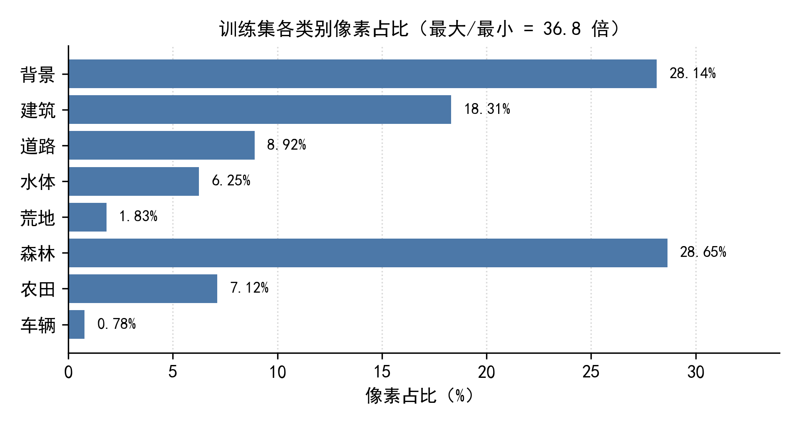
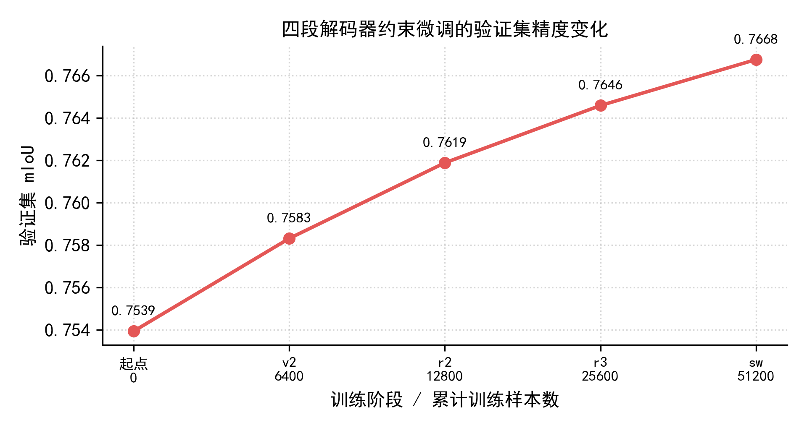
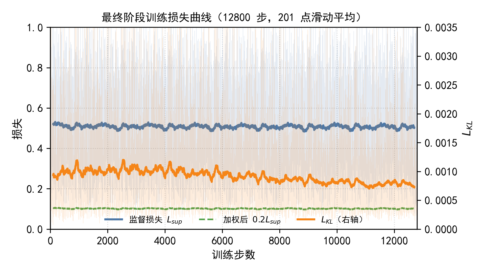
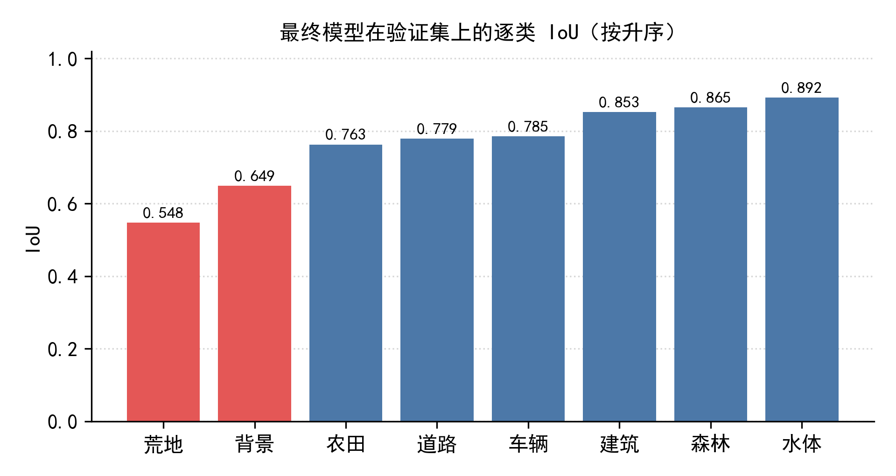

# 实验记录

本文件记录模型迭代过程中的全部实验，包括未达预期的负结果。
所有指标均在 500 张固定验证集上测得（从训练集划出，不参与训练），口径为 8 类平均 IoU。

---

## 1. 数据侧观测

| 项 | 数值 |
|---|---|
| 训练影像 | 6996 张，1024×1024 |
| 训练/验证划分 | 6496 / 500 |
| 类别数 | 9（含忽略类 0） |
| 最大类（森林）占比 | 28.65% |
| 最小类（车辆）占比 | 0.78 |
| 最大/最小倍率 | 36.8× |
| 平均每图类别数 | 4.02 |
| 含忽略类的影像 | 415 张（5.9%） |

**参照实验**：若全部像素判为森林，像素准确率 30.45%，但 mIoU 仅 3.81%。
说明本任务中像素准确率严重失真，必须以 mIoU 为准。

---

## 2. 主线：解码器约束微调

| 阶段 | 父权重 | 步数 | batch | 累计样本 | 验证集 mIoU | 增量 |
|---|---|---|---|---|---|---|
| 起点 | — | — | — | 0 | 0.753938 | — |
| v2 | 起点 | 1600 | 4 | 6400 | 0.758314 | +0.004376 |
| r2 | v2 | 3200 | 4 | 12800 | 0.761884 | +0.003570 |
| r3 | r2 | 6400 | 4 | 25600 | 0.764587 | +0.002703 |
| **sw** | **r3** | **12800** | **4** | **51200** | **0.766757** | +0.002170 |

**观察**：单段增量逐段衰减（0.0044 → 0.0036 → 0.0027 → 0.0022），
第 4 段已接近饱和。继续增加训练量的预期收益低于 0.002。

### 2.1 训练动态

- 监督损失：前 200 步均值 0.5204 → 末 200 步 0.5041（降 3.1%）
- KL 约束：0.00094 → 0.00073（降 22%）

监督损失几乎不动而 KL 持续下降，说明模型对训练数据已拟合饱和，
该段训练的作用是让解码器逐步脱离父模型约束。

---

## 3. 逐类精度

| 类别 | IoU | 主要误差流向 |
|---|---|---|
| 水体 | 0.892 | — |
| 森林 | 0.865 | → 背景 |
| 建筑 | 0.853 | — |
| 车辆 | 0.785 | → 背景 |
| 道路 | 0.779 | → 背景 |
| 农田 | 0.763 | → 森林 |
| 背景 | 0.649 | （垃圾桶类，精确率偏低） |
| 荒地 | 0.548 | → 水体 |

按 mIoU 等权特性，弱类（荒地、背景）各提升 0.10 可带来 +0.025 的总分，
相当于强类（水体）从 0.89 提到 0.98 的两倍以上。

---

## 4. 负结果

以下实验均未带来收益，记录以供参考。

### 4.1 数据增强

| 设置 | 验证集变化 |
|---|---|
| 仅几何（基线） | 0 |
| 几何 + 颜色抖动 | −0.0060 |
| 几何 + 颜色 + 模糊 | −0.0070 |

**分析**：本任务的类别判别高度依赖色度（植被 vs 非植被），破坏颜色分布会削弱这一线索。

### 4.2 推理增强

| 设置 | 验证集变化 |
|---|---|
| 8 路概率平均（基线） | 0 |
| 单尺度（无 TTA） | −0.0035 |
| 分尺度加权 | ≈ 均权，无增益 |
| 追加 1.5/0.5 之外的尺度 | 无增益或负 |

### 4.3 训练策略

| 设置 | 验证集变化 | 说明 |
|---|---|---|
| 解冻 DFR 一并微调（11.07 M 可训） | +0.0007 | 论文称 DFR 贡献最大，但解冻后几乎无增益 |
| 朴素伪标签自训练 | −0.0129 | 回收的低置信区域 52% 实为背景，模型学到"低置信即背景" |
| 全量数据增强重训 | −0.007 | 同上 |

### 4.4 后处理

尝试过 12 种后处理（去小连通域、孔洞填充、形态学开闭、类别偏置、CRF 等），
**全部为负**或无变化，最终确定不做任何后处理。

---

## 5. 跨模型族对照

为验证「换更强骨干是否能突破瓶颈」，训练了 SegFormer-B2（24.7 M）作为对照：

| 模型 | 源域验证集 | 目标域表现 |
|---|---|---|
| Swin-B + KAN（本仓库） | 0.7668 | 稳定 |
| SegFormer-B2 | **0.8071** | 明显退化 |

源域高出 4 个百分点，但迁移到未见航区后精度大幅下降。
**结论：源域指标不能跨模型族选型，域偏移是主要矛盾。**

---

## 6. 方法论教训

实验中曾用少量人工标注的新航区样本做选型，发现其与真实评测结果**系统性反向**：

| 版本 | 标注子集 mIoU | 真实评测 |
|---|---|---|
| 起点 | 0.7279 | 基准 |
| v2 | 0.7186 | 上升 |
| r3 | 0.7034 | 上升 |
| sw | 0.6972 | 上升 |

溯源确认：该批标注以早期模型预测为初稿，度量的实际是「与旧模型的相似度」而非准确度。

**教训**：验证集的构建方式本身会引入偏差，**独立标注比标注数量更重要**；
小样本子集只能用于发现崩溃，不能用于在细差异区间选型。
